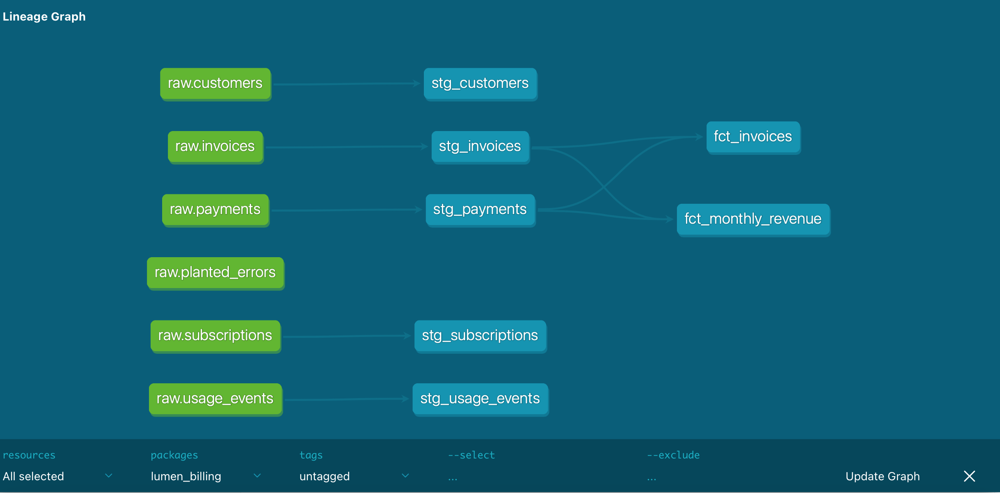

# AI Billing & Revenue Pipeline

I built an end-to-end billing and revenue pipeline for **Lumen AI**, a fictional company that charges customers a subscription plus usage fees for access to its AI models. I generated six months of billing data with known errors, modeled and tested it with dbt, reconciled invoices against payments in SQL, and reported the results in a finance report and a dashboard.


## Why I built this

I spent about four years as a Senior Settlement Analyst at Fiserv / First Data, reconciling settlements and supporting month-end close. I built this project to apply that experience to usage-based billing, the model most AI companies use, with a modern data stack.

## Highlights

- Every planted billing error was found by eight reconciliation rules that never look at the answer key. A dbt test fails the build if that ever changes.
- Four Enterprise customers produce about 61% of billing, a concentration risk worth watching.

## What I built

- **Data generator (Python):** six months of customers, subscriptions, usage, invoices and payments, with 20 planted billing errors and an answer key.
- **Data models (dbt and DuckDB):** staging, mart and report layers, checked by 25 data quality tests.
- **Reconciliation (SQL):** eight rules that match invoices to payments, classify each break, and suggest the fix and journal entry.
- **Reporting:** a [reconciliation report](reports/reconciliation_report.md) for finance and an interactive Streamlit dashboard.

## How it works

```
 Python generator           DuckDB             dbt                          Outputs
 ─────────────────    ──────────────    ─────────────────────────    ──────────────────────
 customers            raw schema         staging   (5 views)          Reconciliation report
 subscriptions   ──►  6 tables     ──►   marts     (2 tables)    ──►  (Markdown)
 usage events                            reports   (2 tables)         Streamlit dashboard
 invoices, payments                      25 tests
 + planted errors
```



## Key design choices

- I planted the errors separately with an answer key, so I could prove the reconciliation works.
- I kept money in integer cents to avoid rounding differences.
- I treated normal reconciling items, like unapplied cash, as warnings instead of failures.

## How I built it

I used Mehdi Ouazza's MotherDuck series as the starting point for the architecture and tools. The billing company, data design, planted errors and reconciliation logic are my own, based on my settlement work. I used Claude (Anthropic) as a pair programmer to explain concepts, write and test code, and review my work. I ran and validated every step and made the design decisions.

More detail: [build log](docs/build_log.md) · [decisions log](docs/decisions_log.md) · [mistakes log](docs/mistakes_log.md) · [lessons learned](docs/lessons_learned.md)

## Run it yourself

Requires Python 3.13. Run from the project root:

```bash
python3.13 -m venv .venv && source .venv/bin/activate
pip install -r requirements.txt
python -m generator.main                                  # generate data and load it into DuckDB
cd transform/lumen_billing && dbt build && cd ../..       # build the models and run 25 tests
python -m reports.build_reconciliation_report             # write the reconciliation report
streamlit run dashboard/app.py                            # open the dashboard at http://localhost:8501
```

## Tech stack

Python · SQL · DuckDB · dbt · Streamlit · Altair · Git

## Credits

Mehdi Ouazza, MotherDuck, *End-to-End Data Engineering Project* ([part 1](https://motherduck.com/videos/90/duckdb-python-end-to-end-data-engineering-project-13) · [part 2](https://www.youtube.com/watch?v=SpfEQQXBGMQ) · [part 3](https://youtu.be/ta_Pzc2EEEo)). Built with help from Claude (Anthropic). All data is fictional. Full credits are in [CREDITS.md](CREDITS.md).
