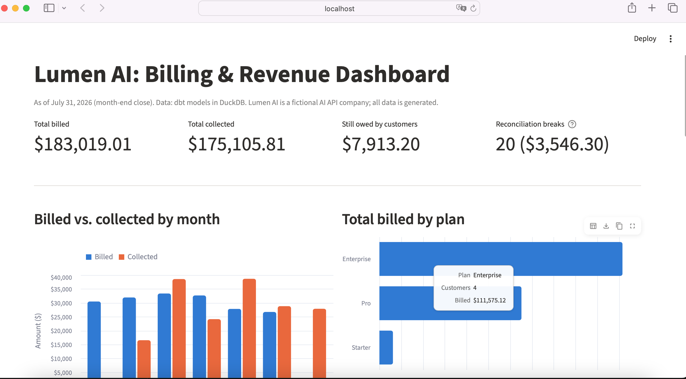

# AI Billing & Revenue Pipeline

An end-to-end billing and revenue pipeline for **Lumen AI**, a fictional company that sells usage-based API access to its AI models. The pipeline generates realistic billing data with known errors, transforms and tests it with dbt, reconciles invoices against payments in SQL, and reports the results through a reconciliation report and an interactive dashboard.

The project structure follows Mehdi Ouazza's *End-to-End Data Engineering Project* series from MotherDuck ([part 1](https://motherduck.com/videos/90/duckdb-python-end-to-end-data-engineering-project-13) · [part 2](https://www.youtube.com/watch?v=SpfEQQXBGMQ) · [part 3](https://youtu.be/ta_Pzc2EEEo)).



## Why I built this

I spent about four years as a Senior Settlement Analyst at Fiserv / First Data, responsible for settlement reconciliation and month-end close. This project applies that domain expertise to usage-based billing, the pricing model used by most AI API companies, with a modern analytics stack.

## Highlights

- Every planted billing error was found by eight reconciliation rules that never look at the answer key. A dbt test fails the build if that ever changes.
- Four Enterprise customers produce about 61% of billing, a concentration risk worth watching.

## Skills and techniques

- **Data generation (Python):** Simulated six months of billing activity with a reproducible generator, including 20 planted billing errors tracked in an answer key.
- **Data modeling (dbt):** Designed a layered model of staging views, mart tables and report tables, connected through `source()` and `ref()`, with a project variable for the report date and a shared macro for currency conversion.
- **Data quality testing:** Implemented 25 dbt tests, including generic column tests, a warning-level test for a known business exception, and a custom test that validates the reconciliation against the answer key.
- **Advanced SQL:** Applied window functions, `QUALIFY`, full outer joins, `UNION ALL` across rule sets, and regular expressions.
- **Reconciliation logic:** Wrote eight rules that match invoices to payments and classify exceptions (unapplied cash, duplicate payments, short payments, unbilled usage, invoice math errors, cutoff errors and aged balances), each with a recommended action and the related journal entry.
- **Reporting and visualization:** Generated a reconciliation report in Python and built an interactive Streamlit dashboard with Altair charts.
- **Engineering practices:** Integer-cent arithmetic for exact money math, idempotent data loads, read-only reporting connections, pinned dependencies, and version control with Git.

## How it works

```
 Python generator           DuckDB             dbt                          Outputs
 ─────────────────    ──────────────    ─────────────────────────    ──────────────────────
 customers            raw schema         staging   (5 views)          Reconciliation report
 subscriptions   ──►  6 tables     ──►   marts     (2 tables)    ──►  (Markdown)
 usage events                            reports   (2 tables)         Streamlit dashboard
 invoices, payments                      25 tests
 + planted errors
```


## Design decisions

- **Planted errors with an answer key.** Errors are introduced in a separate step after the clean data is generated, so every reconciliation result can be verified against a known answer.
- **Staging does not correct data.** Staging models only rename columns and cast types, which keeps errors visible to the tests and the reconciliation.
- **Exact currency handling.** Amounts are stored as integer cents and converted to `DECIMAL(18,2)` by a single dbt macro, which eliminates rounding differences across reports.
- **Business exceptions are warnings, not failures.** Unapplied cash is a normal reconciling item, so its test raises a warning rather than failing the build.
- **No double counting.** When cases overlap, such as an aged invoice that is also short-paid, the item is reported under one break type only.
- **Dashboard tool.** The series uses Evidence, which has changed significantly since it was recorded, so I selected Streamlit instead. See the [decisions log](docs/decisions_log.md).

## How I built it

I used the MotherDuck series as the foundation for the architecture and tooling, then adapted it to the billing domain. I designed the data model and the planted errors from my settlement experience, and built the reconciliation and financial reporting layers on top. I used **Claude** as a technical guide and pair programmer for explaining concepts, writing and testing code, and reviewing my work. I ran every step, validated the results, and made the design decisions.

The full process is documented in the [build log](docs/build_log.md), [decisions log](docs/decisions_log.md), [mistakes log](docs/mistakes_log.md) and [lessons learned](docs/lessons_learned.md).

## Run it yourself

Requires Python 3.13. Run from the project root:

```bash
python3.13 -m venv .venv && source .venv/bin/activate
pip install -r requirements.txt
python -m generator.main                                  # generate data and load it into DuckDB
cd transform/lumen_billing && dbt build && cd ../..       # build the models and run 25 tests
python -m reports.build_reconciliation_report             # write the reconciliation report
streamlit run dashboard/app.py                            # open the dashboard at http://localhost:8501
```

## Project structure

```
generator/                Python data generator: settings, tables, planted errors, DuckDB load
transform/lumen_billing/  dbt project: staging, marts and report models, tests, macro
reports/                  Reconciliation report and the script that writes it
dashboard/                Streamlit dashboard
queries/                  Exploration queries (run with run_sql.py)
docs/                     Build log, decisions, mistakes, lessons, video notes, screenshots
```

## Tech stack

Python 3.13 · DuckDB · dbt Core (dbt-duckdb) · SQL · Streamlit · Altair · Git

## Credits

- **Video series:** Mehdi Ouazza, MotherDuck, *End-to-End Data Engineering Project* ([part 1](https://motherduck.com/videos/90/duckdb-python-end-to-end-data-engineering-project-13) · [part 2](https://www.youtube.com/watch?v=SpfEQQXBGMQ) · [part 3](https://youtu.be/ta_Pzc2EEEo)). It provided the project's foundation: Python ingestion into DuckDB, transformation and testing with dbt, and dashboards as code.
- **Tools:** DuckDB, dbt Core, dbt-duckdb, Streamlit and Altair.
- **Claude (Anthropic):** technical guidance, help writing and testing code, and review of my work.
- **Data:** All data is fictional and generated by this project.
