# Build Log

How the project was built, phase by phase.

## Phase 1: Setup

- Created a Python 3.13 virtual environment and installed `dbt-duckdb`, which brings in dbt Core and DuckDB. Pinned exact versions in `requirements.txt`.
- Set up Git with a `.gitignore` that keeps generated data, the virtual environment and local settings out of the repo.

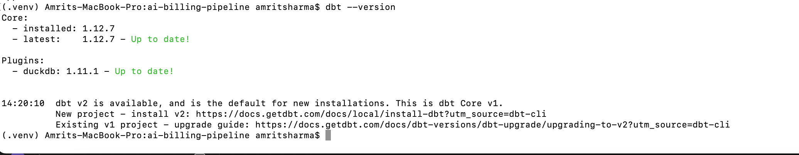

## Phase 2: Generate billing data

**Built**
- A Python package (`generator/`) that creates six months of data for 50 customers: customers, subscriptions, daily usage events, monthly invoices and payments. Settings such as the plans, prices, dates and random seed live in `config.py`.
- `db.py` writes each table to CSV and loads it into DuckDB's `raw` schema with `CREATE OR REPLACE`, so reruns never duplicate rows.
- `errors.py` plants 20 errors of 8 types in the clean invoices and payments, and writes an answer key (`raw.planted_errors`). Each invoice gets at most one error, so every break has one cause.
- `run_sql.py` runs saved queries from `queries/` against a read-only connection.

**Techniques**
- Weighted random choices for the plan mix, a fixed seed for reproducible data, and integer-cent money math with an `assert` that checks the overage formula before any invoice is built.

**Result**
- A two-sided control check (`02_invoice_checks.sql`) compares invoices with usage in both directions. It found **0 / 0 / 0** breaks on clean data and **2 / 3 / 2** after planting (understated usage, math errors, missing invoices), which matches the answer key exactly.
- Final data: 274 invoices, 264 payments, $183,019.01 billed and $175,105.81 collected.

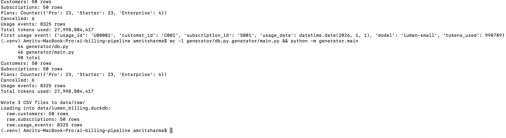
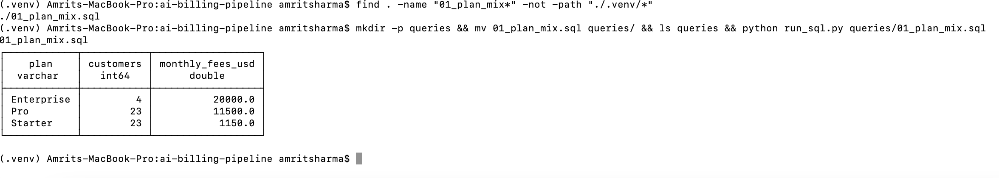
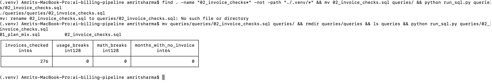
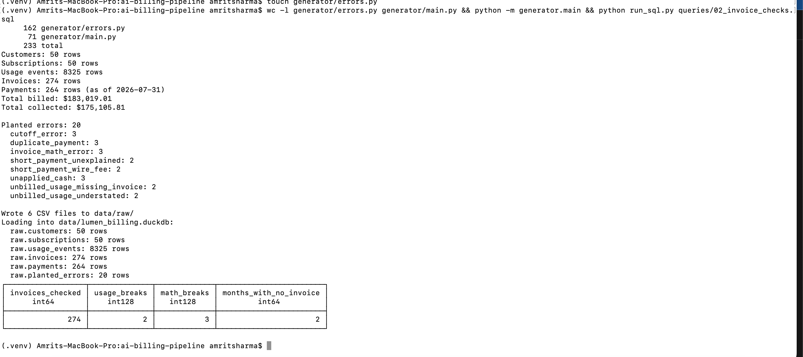

## Phase 3: dbt models and tests

**Built**
- A dbt project (`transform/lumen_billing/`) connected to the DuckDB file through a project-level `profiles.yml`, with the 6 raw tables declared in `sources.yml`.
- 5 staging views that rename columns and convert types only, so planted errors stay visible.
- 2 mart tables: `fct_invoices` (amount paid, balance due, payment status, days past due and aging bucket as of the report date) and `fct_monthly_revenue` (billed by service month vs. collected by payment month).
- A `cents_to_dollars` macro for exact `DECIMAL(18,2)` conversion, and a `report_date` project variable.

**Techniques**
- `source()` and `ref()` for dependencies, a full outer join to line up billed and collected months, and `CASE` logic for payment status and aging buckets.
- Generic tests for keys, relationships and allowed values. The "every payment has an invoice" test is set to `severity: warn` and flagged the 3 unapplied cash payments.

**Result**
- The full build passed with 1 expected warning. The marts tie out: applied payments ($174,017.73) plus unapplied cash ($1,088.08) equal total collected ($175,105.81).
- The lineage graph from `dbt docs` shows raw sources → staging → marts.

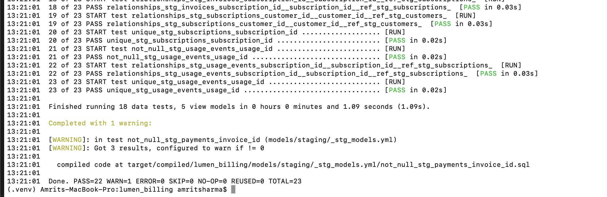
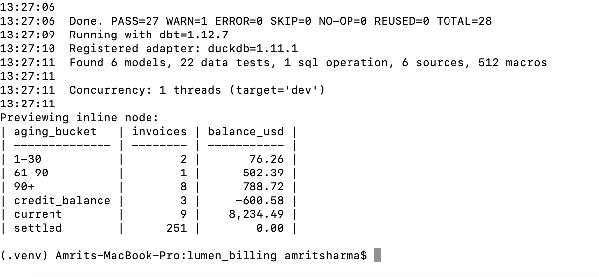
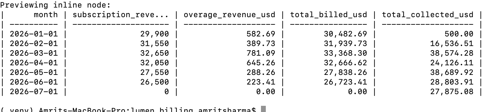
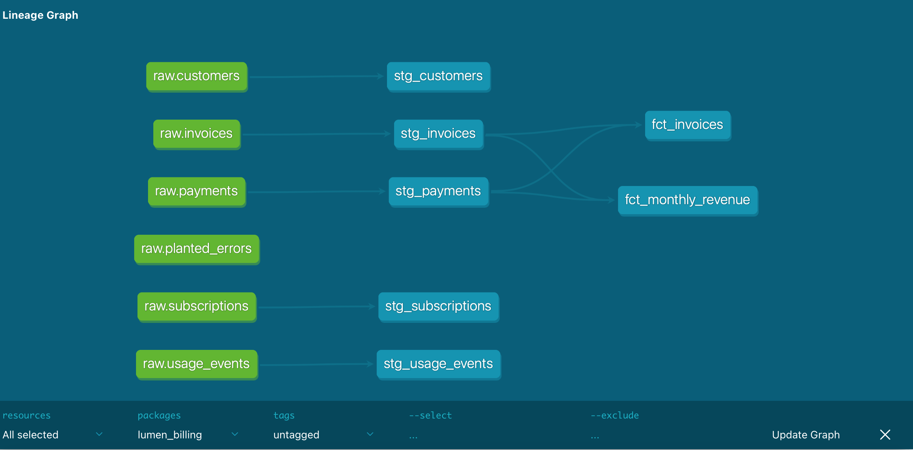

## Phase 4: Reconciliation report

**Built**
- `rpt_reconciliation_breaks`: 8 rules combined with `UNION ALL`, each giving a dollar amount, details, a suggested action, and debit and credit accounts.
- `rpt_reconciliation_vs_answer_key` and a singular test that fails the build if any planted error is missed or an extra break appears.
- `build_reconciliation_report.py`, which reads the dbt results through a read-only connection and writes a [Markdown report](../reports/reconciliation_report.md): summary, AR tie-out, breaks by type, journal entries, details, aging and the answer key check.

**Techniques**
- `row_number()` and `first_value()` to find duplicate payments, `QUALIFY` to match unapplied cash to open invoices by customer and amount, `regexp_extract()` to match missing invoices to the answer key, and exclusions so each break is counted once.

**Result**
- **20 of 20 planted errors found, 0 missed, 0 extra.** Final build: 9 models and 25 tests (PASS=33, WARN=1, ERROR=0).
- AR ties out: $183,019.01 billed − $174,017.73 applied − $1,088.08 unapplied = $7,913.20 still owed.

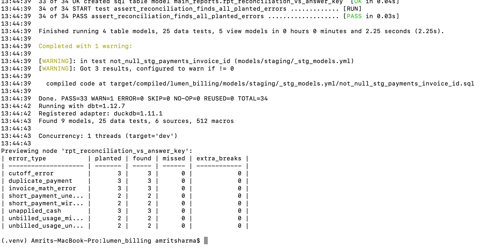
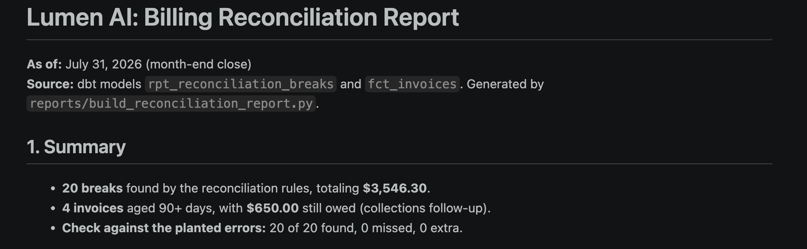
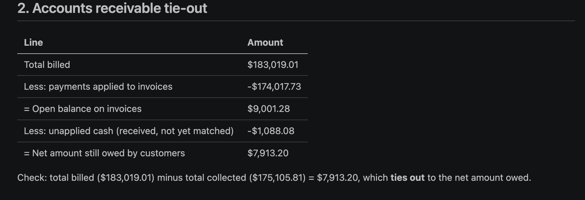
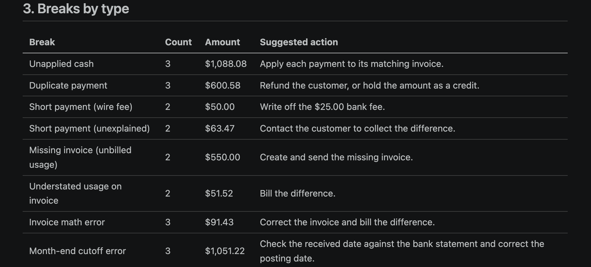

## Phase 5: Dashboard

**Built**
- `dashboard/app.py`, a Streamlit app that reads the dbt models through a read-only connection and shows 4 headline numbers, billed vs. collected by month, total billed by plan, aging, breaks by type, and a filterable break details table.

**Techniques**
- Altair charts with grouped bars, tooltips and a color-blind-safe palette. pandas `reindex` to show empty aging buckets. `width="stretch"` for responsive layout.

**Result**
- The dashboard shows revenue concentration (4 Enterprise customers, about 61% of billing) and the cutoff error (cash received in January, before any invoice).

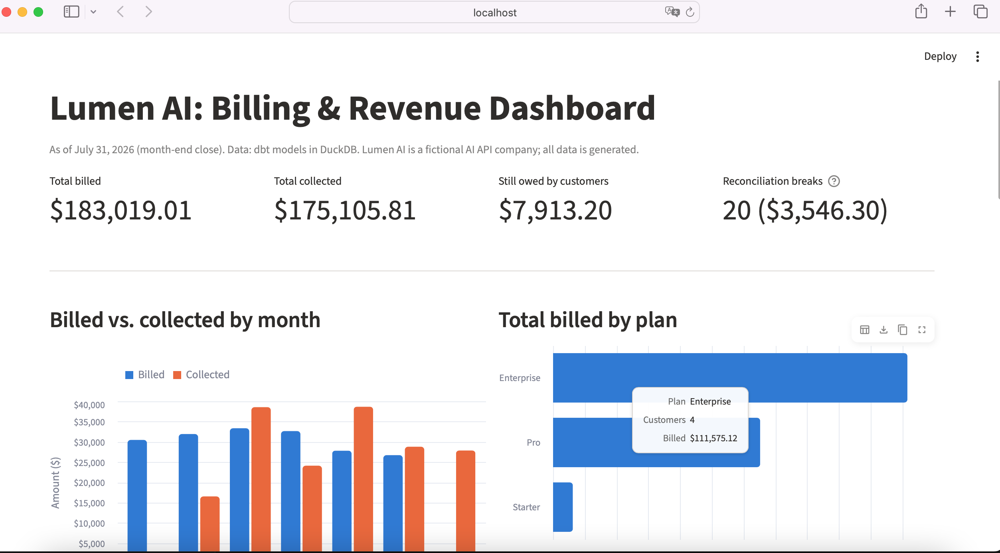
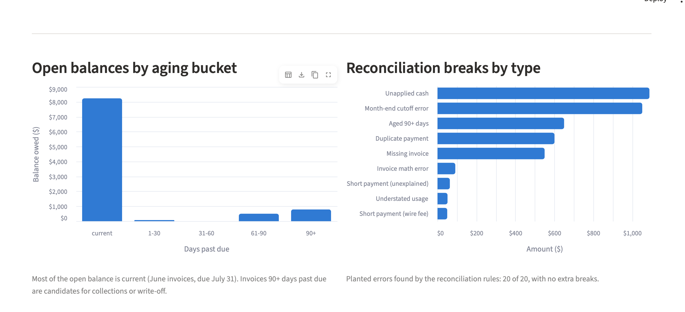
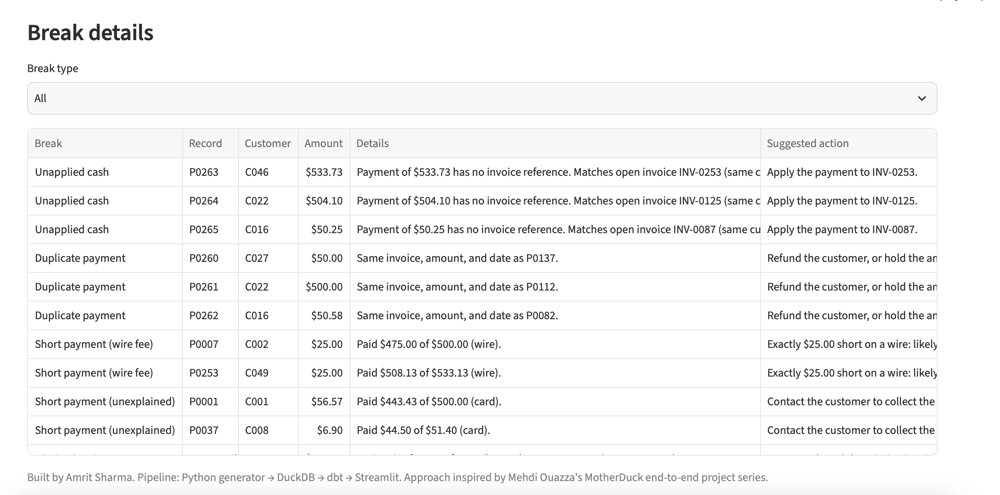
